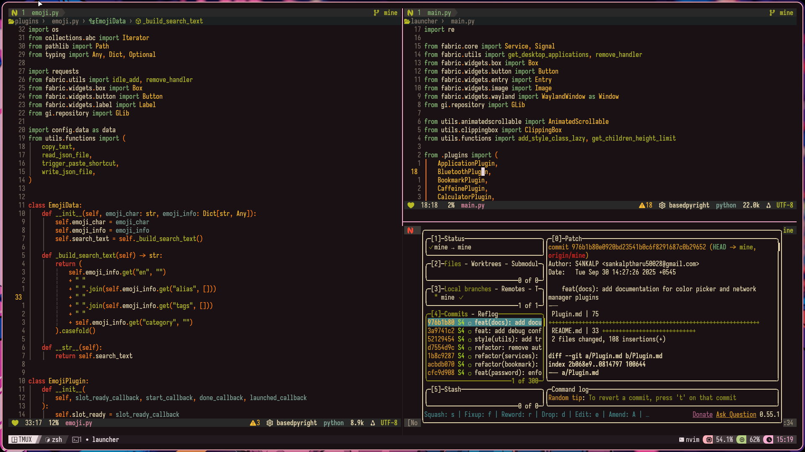

<div align="center">

<h1>
  <a href="https://S4NKALP.github.io/keycodex">KeyCodeX</a>
</h1>

<p>
  <a href="https://github.com/S4NKALP/keycodex/blob/main/LICENSE">
    
  </a>
  <a href="https://github.com/S4NKALP/keycodex/stargazers">
    
  </a>
  <a href="https://github.com/S4NKALP/keycodex/pulse">
    
  </a>
</p>

> All commit messages in this repo are AI-generated using [DevGen](https://github.com/S4NKALP/DevGen)

<h3>Handcrafted Neovim setup for the ultimate CLI development experience. ❤️‍👨‍💻</h3>

<figure>
  
</figure>

</div>

---

## ✨ Features

- **📦 Native Plugin Management**
  - Uses Neovim's built-in `vim.pack` and a committed `nvim-pack-lock.json` for reproducible installs.
  - Interactive manager with `:PackUI` / `<leader>ps` (update, delete, inspect, open plugin paths).
  - Missing plugins are installed by `vim.pack.add()` on the first launch.

- **🚀 Powered by [Snacks.nvim](https://github.com/folke/snacks.nvim)**
  - **Picker**: files, grep, projects, git log/status/branches, LSP symbols, undo, todo comments.
  - **Notifier**: notification history (`<leader>oN`) and LSP attach messages.
  - **Indent / Statuscolumn / Zen / Dim / Rename / Bufdelete / Profiler**.

- **🎨 UI & UX**
  - Custom `KEYCODEX` start screen (`lua/dashboard.lua`), no dashboard plugin.
  - `gruvbox` with hand-tuned highlights, transparent background.
  - **Mini ecosystem**: files (`<leader>ee`), icons, pairs, ai textobjects, surround, splitjoin,
    bracketed motions, diff overlay, custom statusline.
  - **Smart column**: `colorcolumn` appears only when a line exceeds 120 columns.

- **🛠️ Developer Productivity**
  - **LSP**: native `vim.lsp.config` / `vim.lsp.enable`, Mason for installation.
  - **Completion**: `blink.cmp` with Rust fuzzy matcher, LSP/path/snippet/buffer sources.
  - **Format on save**: `conform.nvim`; toggle with `<leader>tf`, skip with `<leader>wn`.
  - **Lint on save and on insert leave**: `nvim-lint`.
  - **Treesitter**: `nvim-treesitter` highlighting + indentation for configured languages.
  - **Git**: `gitsigns` (signs, inline blame), `mini.diff` overlay (`<leader>gd`), `codediff` history.
  - **Secure env**: `.env` values are masked on open, `<leader>et` toggles.
  - **Auto-directory**: saving `dir/new_file` creates parent folders.
  - **Paste reindent**: pasted code snaps to the surrounding indentation.
  - **OpenCode**: in-editor AI panel under `<leader>O`.

---

## 💻 Installation

```bash
# System tools first: see prerequest.txt
git clone https://github.com/S4NKALP/keycodex ~/.config/nvim

# Launch Neovim - missing plugins install automatically
nvim
```

The first launch also installs every LSP server, formatter, linter and tree-sitter parser listed
in [`lua/extensions.lua`](./lua/extensions.lua) via Mason's `ensure_installed`. `:Mason` is only
needed to add or remove tools by hand, and `:TSInstallAll` to re-run the parser install.

---

## 📂 Project Structure

- [`init.lua`](./init.lua) - Entry point.
- [`lua/`](./lua/) - Core logic.
  - [`pack_helper.lua`](./lua/pack_helper.lua) - `add()` wrapper over `vim.pack` + build hooks.
  - [`packui.lua`](./lua/packui.lua) - Interactive plugin manager UI.
  - [`keys.lua`](./lua/keys.lua) - Leader, base keymaps, yank/copy helpers.
  - [`options.lua`](./lua/options.lua) - Options, providers, `filetype` additions.
  - [`autocmd.lua`](./lua/autocmd.lua) - Smart column, `.env` masking, auto-mkdir, LSP attach.
  - [`lsp.lua`](./lua/lsp.lua) - Per-server LSP settings and capabilities.
  - [`paste.lua`](./lua/paste.lua) - Reindent pasted text.
  - [`dashboard.lua`](./lua/dashboard.lua) - `KEYCODEX` start screen.
  - [`extensions.lua`](./lua/extensions.lua) - Lists of parsers, servers, formatters, linters.
- [`plugin/`](./plugin/) - Plugin configuration (loaded in filename order).
  - [`01-lsp.lua`](./plugin/01-lsp.lua) - Mason.
  - [`coding.lua`](./plugin/coding.lua) - conform, nvim-lint, todo-comments, code actions, diagnostics.
  - [`editor.lua`](./plugin/editor.lua) - blink.cmp, Navigator, hardtime, visual-multi, tabout, hlslens.
  - [`git.lua`](./plugin/git.lua) - gitsigns, codediff.
  - [`mini.lua`](./plugin/mini.lua) - Mini modules and statusline.
  - [`snacks.lua`](./plugin/snacks.lua) - Snacks modules, layouts, LSP notifications.
  - [`tools.lua`](./plugin/tools.lua) - OpenCode, toggleterm, wakatime.
  - [`treesitter.lua`](./plugin/treesitter.lua) - Parsers, highlighting, autotag, matchup.
  - [`ui.lua`](./plugin/ui.lua) - Colorscheme, markview, color highlighter, showkeys.
  - [`whichkey.lua`](./plugin/whichkey.lua) - Keymap groups and labels.

---

## ⌨️ Keybindings

Leader is `<Space>`. Pressing `<leader>` waits for **which-key** to list everything.

| Key | Action |
| --- | --- |
| `<leader>ff` | Find files |
| `<leader>fg` | Live grep |
| `<leader>fp` | Projects |
| `<leader>ee` | File explorer (mini.files) |
| `<leader>ef` | Open file under cursor (paths, `path:line`, Python imports) |
| `<leader>ps` | Plugin manager (`:PackUI`) |
| `<leader>.` | Code action |
| `<leader>rr` | Rename symbol |
| `<leader>rd` / `<leader>rj` | Definition / usages |
| `<leader>cf` | Format buffer |
| `<leader>tf` | Toggle autoformat |
| `<leader>wn` | Write without formatting |
| `<leader>oc` | Toggle codelens |
| `<leader>gd` | Toggle diff overlay |
| `<leader>wz` | Zen mode |
| `<leader>t1` / `<leader>t2` | Toggle terminal |
| `<C-hjkl>` | Move across tmux/nvim splits |
| `<C-\>` | Previous pane |

---

<div align="center">
  <p>Handcrafted with ❤️ by <a href="https://github.com/S4NKALP">Sankalp</a></p>
</div>
